# Kahoot Portal

Live multiplayer quiz games. A host opens a lobby on a big screen and players join from their phones with a six-digit code (or the QR code). Faster correct answers score more, and every game counts toward a monthly leaderboard.

**Stack:** Next.js 16 (App Router, Turbopack) · React 19 · Tailwind CSS 4 · shadcn/ui on Radix · Motion · Supabase (Postgres, Auth, Realtime, Storage).

## Screenshots

### Host (big screen)

| Lobby | Question |
| --- | --- |
| 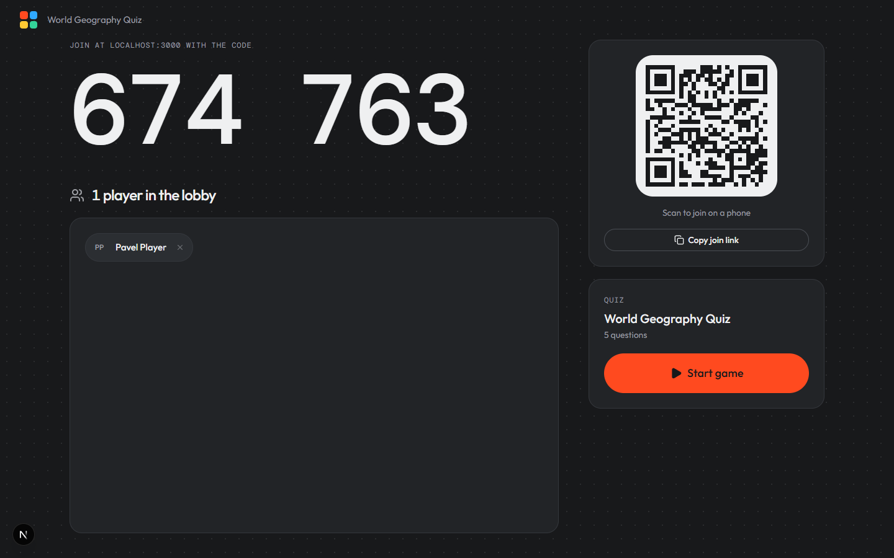 | 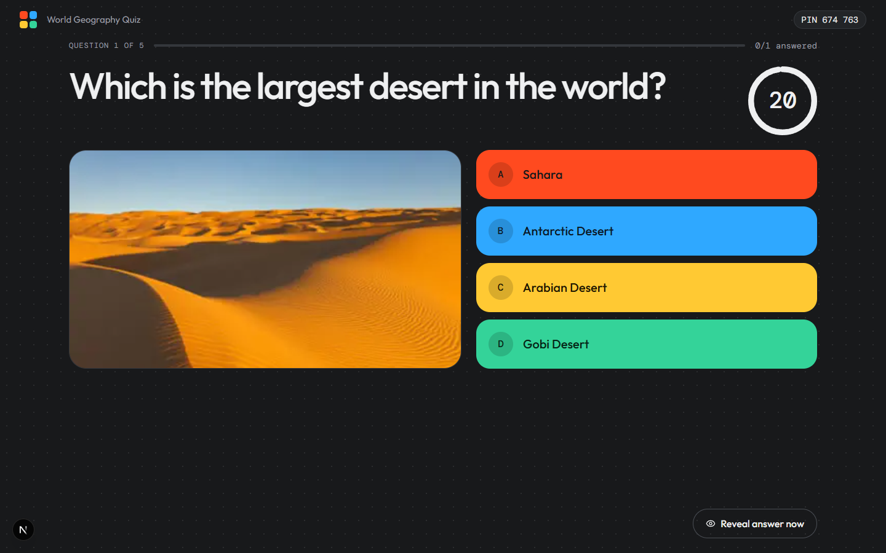 |
| **Reveal** | **Final results** |
| 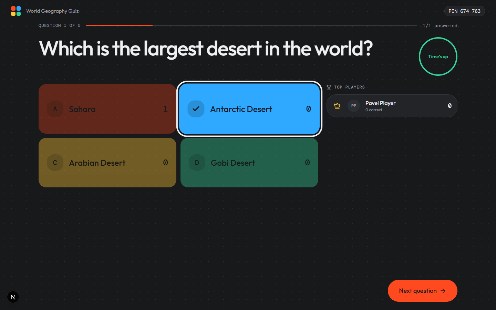 | 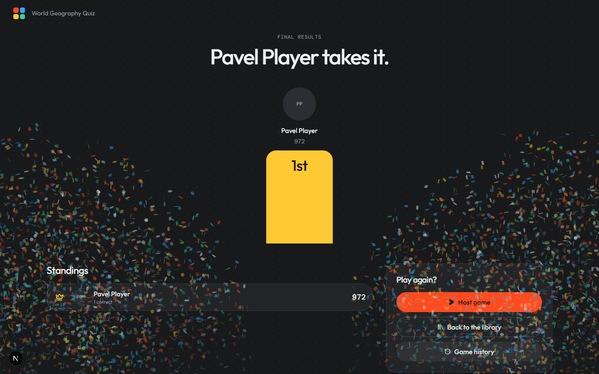 |

### Player (phone)

| Lobby | Question | Reveal | Results |
| --- | --- | --- | --- |
| 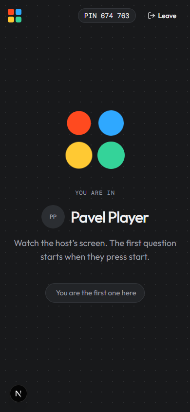 | 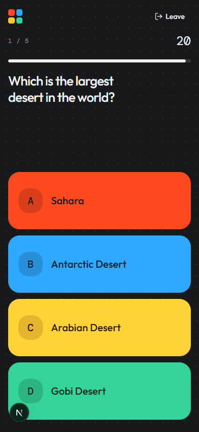 | 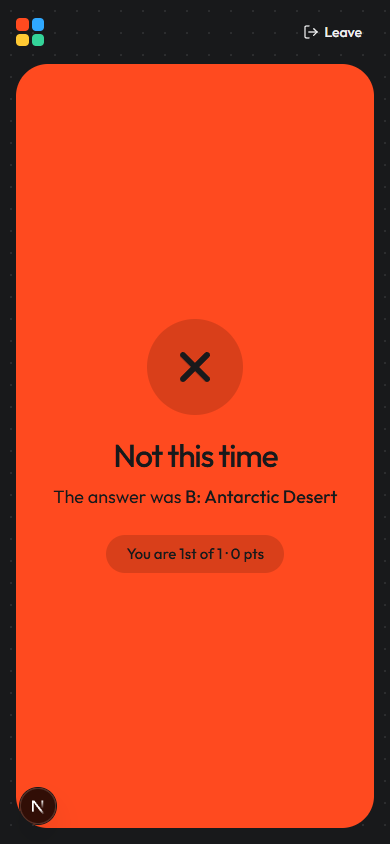 | 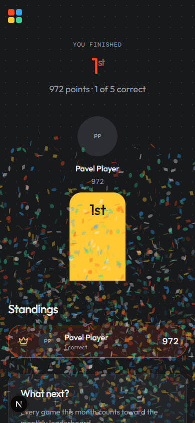 |

### App

| Sign in | Join with a code |
| --- | --- |
| 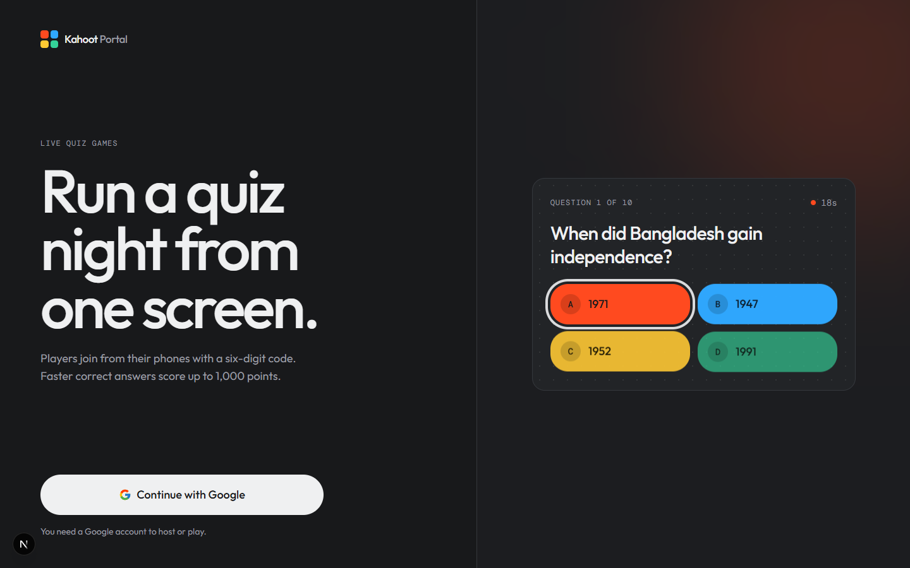 | 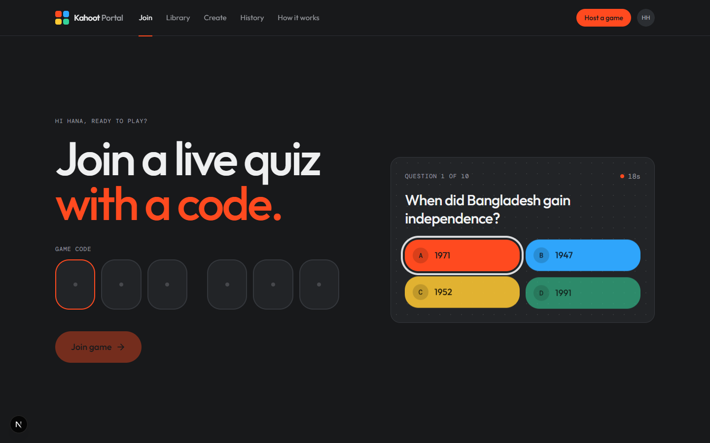 |
| **Library** | **Create a quiz** |
|  | 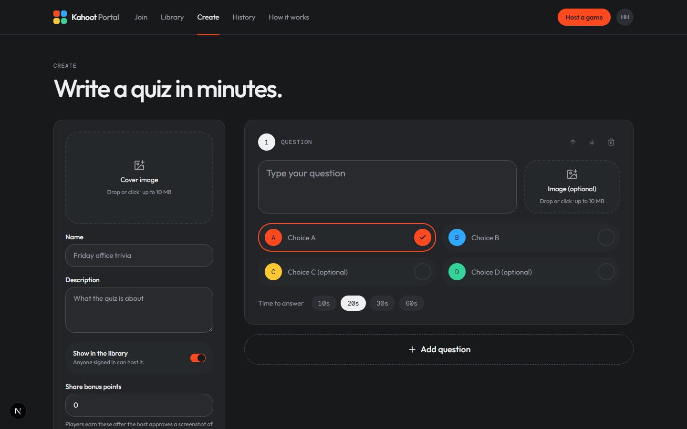 |
| **History and monthly leaderboard** | **How it works** |
| 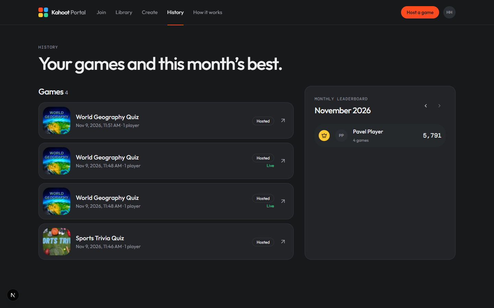 | 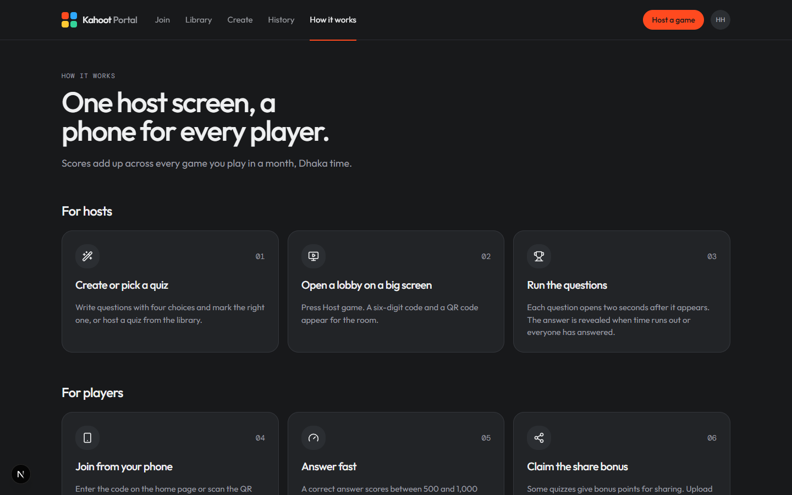 |

## How a game runs

| Phase | Host (`/host/[id]`) | Player (`/game/[id]`) |
| --- | --- | --- |
| Lobby | Code, QR, players popping in (can remove players) | "You are in" screen |
| Question | Question, image, countdown, live answer count | Four answer tiles; locked in after a tap |
| Reveal | Answer distribution, top five | Correct or wrong, points gained, current rank |
| Results | Podium, standings, share-bonus review | Final rank, podium, share-bonus upload |

The `games` row is the shared state; every client follows it over Supabase Realtime and resyncs on focus.

### Scoring and fairness

- Answers are scored in the database (`private.score_answer` trigger): a correct answer is worth 500 to 1,000 points depending on speed. Answers outside the open window are rejected.
- Question start times are stamped by the database clock, and clients correct for skew with `server_now()`.
- `choices.is_correct` is never readable by clients. The correct choice comes from `get_correct_choice()` only after the reveal.
- Standings, history and the monthly leaderboard are `SECURITY DEFINER` RPCs that check the caller is the host or a player. The leaderboard uses Dhaka month boundaries.

## Routes

- `/`: join with a code
- `/library`: host a quiz
- `/create`: create a quiz
- `/history`: your games and the monthly leaderboard
- `/how-to`: how the game works
- `/login`: Google sign-in

Everything except `/login` and `/auth/*` requires sign-in (`src/proxy.ts`).

## Setup

1. Install: `npm install` (Node 22+).
2. Copy the environment variables into `.env.local`:

   ```bash
   NEXT_PUBLIC_SUPABASE_URL=https://<ref>.supabase.co
   NEXT_PUBLIC_SUPABASE_PUBLISHABLE_KEY=sb_publishable_...
   NEXT_PUBLIC_SITE_URL=http://localhost:3000   # origin used for join links and QR codes
   SUPABASE_DB_PASSWORD=...                      # for supabase db push
   ```

3. Apply the database: `npx supabase link --project-ref <ref>`, then `npx supabase db push --remote --include-seed`, then `npx supabase seed buckets --remote` (uploads the sample quiz images).
4. Enable Google sign-in:
   - In Supabase, go to Authentication → Sign In / Providers → Google and paste the client ID and secret.
   - In Google Cloud, add `https://<ref>.supabase.co/auth/v1/callback` as an authorised redirect URI.
   - In Supabase, under Authentication → URL Configuration, set the Site URL and add `<site>/auth/callback` to the redirect URLs.
5. Run: `npm run dev`.

Regenerate database types after schema changes with `npm run db:types`.

## Scripts

`npm run dev` · `npm run build` · `npm run lint` · `npm run typecheck` · `npm run db:types`
